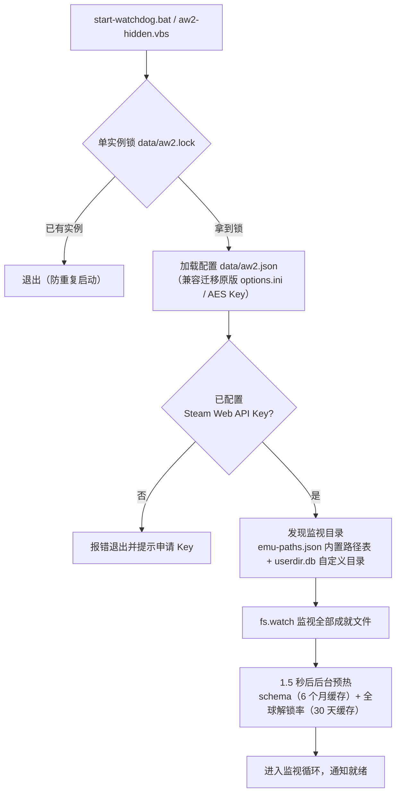
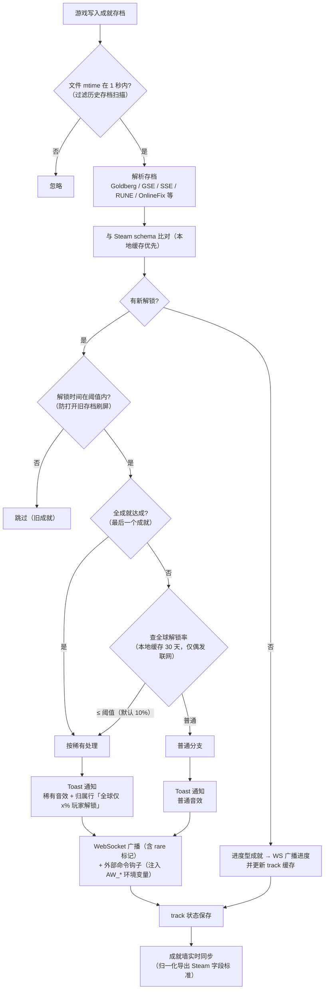
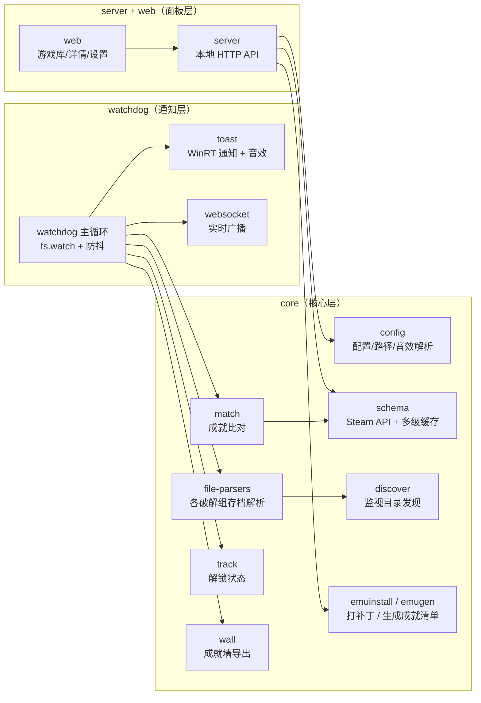

# Achievement Watcher NG (aw2)

原 [xan105/Achievement-Watcher](https://github.com/xan105/Achievement-Watcher) 的重写版（Phase 0+1+2：核心解析 + 实时通知 + 图形面板）。
Node 22+ ESM，仅依赖 `ws`，无原生模块。

## 来源与致谢（Attribution）

本项目思路与兼容性设计源自 [xan105/Achievement-Watcher](https://github.com/xan105/Achievement-Watcher)（LGPL-3.0）：
成就存档解析的格式知识（Goldberg / CODEX / 3DM / SmartSteamEmu 等路径与文件结构）、Steam Web API schema 缓存策略、
Toast/WebSocket 通知形态均参考原项目。代码为独立重写（Node ESM、零原生依赖），未复制原项目源码，
故同样以 [LGPL-3.0](LICENSE) 发布。感谢原作者 xan105。

## 快速开始（新人三步）

1. **装环境**：Node.js 18+，然后在项目目录执行 `npm install`；再进 `electron\` 执行一次 `npm install`（Electron 桌面版运行时）
2. **填 API Key**：`node src\cli.js setkey <KEY>`（[免费申请](https://steamcommunity.com/dev/apikey)）
3. **双击 `aw2-desktop.vbs`**：右下角出现奖杯托盘图标即启动成功（后台监视 + 自绘弹窗 + 面板服务全在这一个进程里）

之后所有配置（游戏目录、下载成就、打补丁、音效、稀有阈值）都在面板里改：**点托盘图标**或浏览器打开 `http://127.0.0.1:5179`。成就解锁时右下角滑入 Xbox 风格卡片（普通绿条 5 秒 / 稀有金条 10 秒，稀有音效可自备）。

> 不想用桌面版？`start-ui.bat` + `start-watchdog.bat` 是等价的手动组合（面板与本机 Node 环境独立跑）。

## 脚本一览

| 脚本 | 作用 |
| --- | --- |
| `aw2-desktop.vbs` | **推荐入口**：Electron 桌面版（后台监视 + 自绘弹窗 + 内置面板 + 托盘图标），静默运行 |
| `start-ui.bat` | 只启动图形面板（游戏库 / 成就详情 / 设置），自动开浏览器 `http://127.0.0.1:5179` |
| `start-watchdog.bat` | 启动后台通知（带日志窗口，测试用） |
| `aw2-hidden.vbs` | 无窗口隐藏启动后台通知（带崩溃自动重启） |
| `stop-watchdog.bat` | 停止后台通知（只动 aw2 自己的进程） |
| `install-autostart.vbs` / `uninstall-autostart.vbs` | 注册 / 取消开机自启（打包后再启用） |

## 使用（命令行）

```cmd
cd aw2

:: 图形面板（游戏库/成就/设置）
node src\cli.js ui

:: 扫描本机成就存档（内置模拟器目录 + 用户自定义目录）
node src\cli.js scan

:: 查看某游戏成就状态（appid 或成就文件路径）
node src\cli.js list 2407270

:: 设置 Steam Web API Key（https://steamcommunity.com/dev/apikey 免费）
node src\cli.js setkey <KEY>

:: 启动实时通知（监视成就文件，解锁时弹 Toast + WebSocket 广播）
node src\cli.js watch

:: 为 Goldberg 系模拟器游戏生成/补齐成就配置（achievements.json + 图标）
node src\cli.js emu-gen 1593500 "F:\Games\GodOfWar"
::   省略目录时自动在 F:\Games 按 steam_appid.txt 搜索；--no-icons 跳过图标下载
::   已有旧配置时自动备份并报告新增/移除的成就；图标文件已存在的沿用旧路径

:: 安装/更新模拟器源（gbe_fork release 的 .7z 或解压目录，自动识别新旧包结构）
node src\cli.js emu-source "D:\GameTools\gbe_fork-emu-win-release.7z"
::   默认装到 <数据目录>\tools\steam-emu；想装到别处（如移动硬盘）用
::   node src\cli.js path set emuRoots <目录> 再重跑本命令；emu-apply 也可 --source 临时指定
::   不装也能用：项目 vendor\steam-emu\ 内置了一份 gbe_fork（LGPL-3.0，见 vendor\steam-emu\README.md），
::   首次打补丁时自动解压 regular 版 DLL 到 <数据目录>\tools\steam-emu；想升级版本时再手动 emu-source

:: 一键给游戏装模拟器（备份原 DLL 为 .aw2bak，自动生成成就配置，可回滚）
node src\cli.js emu-apply <appid> [游戏目录] [--steamclient] [--dry-run] [--no-icons]
node src\cli.js emu-restore <appid>

:: 发送测试 Toast
node src\cli.js test-toast
```

## 图形面板

- 本地 HTTP + 原生 DOM，零构建、零前端依赖，只监听 `127.0.0.1`，**端口默认 5179、固定不跳号**（被占用时报错退出并提示；可在设置页改端口，或环境变量 `AW2_UI_PORT` 临时指定）
- 游戏库：封面 / 完成度进度条 / 搜索 / 排序（最近解锁、完成度、名称）；有 schema 缓存但存档已删的游戏也会列出并标记「无存档」
- 成就详情：已解锁/未解锁、图标、描述、解锁时间、进度型成就（`12 / 20`）
- 设置：Steam Key（掩码显示，留空不修改）/ 备用 Key / 语言 / 通知开关 / 旧成就阈值 / 冷却 / WebSocket 端口 / 监视目录一览
- 深链接：`#game/<appid>`、`#settings`
- **⬇ 下载成就**：把库里所有游戏的成就清单（名称/描述/图标地址）一次性预取到本地，之后离线也能显示并弹通知；watchdog 启动时也会自动在后台预热一遍，避免「首次解锁才联网」导致通知延迟
- **🔧 打补丁**：网页里浏览并选中游戏目录 → 自动按 `steam_appid.txt` 识别 AppID → 生成 `steam_settings` 成就清单与图标 → 备份（`.aw2bak`）并替换 Goldberg 模拟器 DLL → 顺手预下载该游戏的 Steam 成就数据。选目录时会**检测是否已打过补丁**（已有 Goldberg 系 DLL / 已生成成就清单 / 已有 `.aw2bak`），避免重复操作
- API：`GET /api/library[?refresh=1]`、`GET /api/game/<appid>`、`GET|POST /api/settings`、`POST /api/schema/prefetch`、`POST /api/emu/apply`、`GET /api/fs/list?path=`、`GET /api/health`

## 成就墙（Achievement Wall）

把所有模拟器/破解组的成就**归一化为 Steam 成就字段标准**，导出为自建成就墙的数据源。**默认导出到 `<项目>\data\AchievementWall`**（随项目文件夹走），也可以指定自己的目录：

```cmd
:: 指定目录并立即全量导出（之后 watchdog 每次解锁会实时同步）
node src\cli.js wall "D:\GameTools\AchievementWall"

:: 重新全量导出（图标断点续传） / 关闭 / 用默认目录重新开启
node src\cli.js wall
node src\cli.js wall off
node src\cli.js wall on
```

目录结构（每个游戏一个以 Steam appid 命名的文件夹）：

```
<成就墙>/
├─ index.json                 全部游戏摘要（名称/完成度/最后解锁时间，目录页用）
└─ <appid>/
   ├─ schema.json             Steam schema 标准：name/displayName/description/hidden，
   │                          icon、icongray 指向本地 icons/ 相对路径
   ├─ progress.json           [{ name, achieved, unlockTime, curProgress, maxProgress }]
   │                          （name=Steam apiname，achieved=0/1，unlockTime=Unix 秒）
   └─ icons/                  彩色+灰色图标（按 Steam CDN hash 命名）
```

## 成就音效（自定义）

项目**不内置任何音效文件**（官方音效有版权），请自备两个音频后按固定文件名放到数据目录的 `sounds\` 下：

```
<项目>\data\sounds\
├─ normal.mp3     普通成就解锁音效
└─ rare.mp3       稀有成就 / 全成就达成音效
```

- 支持 `.mp3` / `.wav`。文件名必须是 `normal.mp3` 和 `rare.mp3`（想用 wav 就把扩展名一起改成 `.wav`，或直接在设置页填自己的路径）。
- 文件不存在时自动回落系统默认提示音，不会报错。
- **稀有判定**：全球解锁率 ≤ 阈值（默认 10%，设置页可改）即视为稀有；**解锁最后一个成就（全成就）固定按稀有处理**。
- 也可以在面板「⚙ 设置 → 普通成就音效 / 稀有成就音效」里改成绝对路径、`system:Notification.IM` 等系统音，或填 `silent` 静音。
- 音效跟着项目走（相对路径以数据目录为基准），换电脑整包拷走不用改路径。

> **版权提示：** Xbox / PlayStation 等平台的官方成就音效版权归各自权利人所有，本项目不附带、也不建议随项目再分发。自用请自行从合法渠道获取；若要公开发布带音效的整包，请换成 CC0 / 自有版权音频。

## 程序流程

### 启动流程



### 成就解锁通知流程



### 模块结构



## 兼容性设计

- 兼容原版数据：如设置了 `AW2_DATA_ROOT` 指向旧版 `%APPDATA%\Achievement Watcher\`，可复用其 schema 缓存（6 个月）、track 状态缓存、`cfg/userdir.db`、`cfg/options.ini`（语言/key 自动迁移，key 沿用原 AES 混淆格式）。
- 无 Key 也能看缓存过的游戏；联网失败自动回退过期缓存。
- 去服务器化：不再依赖已关停的 `api.xan105.com`，schema 直接走 Steam Web API。
- WebSocket 通知格式与原版一致（`{appID, game, achievement, displayName, description, icon, time, progress?}`），默认端口 8082，支持 `{"cmd":"test"}`。

## 结构

```
src/
├─ shared/    ini解析 / fs工具 / crc32 / reg.exe+tasklist封装 / 日志 / 单实例锁
├─ core/      emu-paths.json(模拟器路径表,数据驱动) / discover(来源发现)
│             normalize(Goldberg/hoodlum/3DM/CODEX/SSE bin 格式解析)
│             schema(Steam API+缓存) / match(crc32+大小写不敏感) / track(状态缓存) / config
├─ watchdog/  文件监视+防重复通知 / Toast(PowerShell WinRT 自实现) / WebSocket 广播
├─ server.js  本地 HTTP API（面板后端）
├─ cli.js     命令行入口
web/          index.html / style.css / app.js（无框架）
```

## 测试

```cmd
npm test    # 8 个格式解析/匹配单测
```

## 已知限制（相对原版）

- 游戏时长统计（WMI）、截图/录像、GNTP 未移植（按需求不做）
- 进程运行检查默认关闭（原版依赖已死的 gameIndex 服务器；时间阈值 10s 已兜底防旧档误报）
- 面板是本地 Web 形态（后续可套 Electron/Tauri 壳，接口不变）

## 新增计划（可扩展点）

- 加新模拟器：在 `src/core/emu-paths.json` 追加目录/文件名即可
- 加通知通道：在 `src/watchdog/notify/` 实现同签名函数
- 外部命令钩子：解锁时执行任意程序，注入 `AW_APPID/AW_GAME/AW_ACHIEVEMENT/AW_DISPLAYNAME/AW_DESCRIPTION/AW_ICON/AW_TIME` 环境变量（在 aw2.json 的 `action.target` 配置）

## 配置与部署

### 配置文件

全部配置集中在数据目录的 `aw2.json`（GUI 设置页改的就是它）。字段含义与示例见 [`config.example.json`](config.example.json)。查看/设置路径：

```cmd
node src\cli.js path                                :: 查看全部生效路径（标注 默认/自定义）
node src\cli.js path set wall <目录>                 :: 成就墙导出目录（留空用默认 <数据目录>\AchievementWall）
node src\cli.js path set emuRoots <目录...>          :: 模拟器源安装根（emu-apply 取 DLL 处）
node src\cli.js path set emuExtraSources <目录...>   :: 额外只读模拟器源
node src\cli.js path set gameSearchDirs <目录...>    :: emu-gen/emu-apply 自动找游戏的搜索根
node src\cli.js path reset <字段>                    :: 恢复内置默认
```

代码里**不含任何个人路径**；内置默认都是通用值，个人路径一律写在 `aw2.json` 的 `paths.*` 里。

### 数据目录在哪

**默认就是项目文件夹里的 `data\`（便携式设计）**——配置、缓存、成就墙全在项目内，不在系统任何地方留东西；不想要了直接删除项目文件夹即彻底清空。也可用环境变量 `AW2_DATA_ROOT` 指到别处（如 `%APPDATA%`）。
`data\` 里存放：`aw2.json`（配置，含加密的 Steam Key）、`cfg/userdir.db`（自定义监视目录）、`steam_cache/`（成就 schema 与图标缓存，6 个月有效）、`track/`（解锁状态）、`tools/emu-install/`（模拟器安装清单，回滚用）、`AchievementWall/`（成就墙默认导出目录）。

### 拷贝到其他电脑

1. 目标机装 Node.js 18+（启动脚本会自动找）
2. 拷贝整个项目文件夹（或整个盘）——配置、缓存、成就墙全在里面，无需额外步骤
3. 游戏安装路径不同的话，改 `path set gameSearchDirs` / 重新 `scan`

仅支持 Windows（Toast 通知依赖系统 WinRT）。

## 更新记录（Changelog）

### 2026-10-24

- **稀有成就检测 + 双音效**（`34c74a0`）：解锁时对比 Steam 全球解锁率（`GetGlobalAchievementPercentagesForApp`，本地缓存 30 天，启动预取），解锁率 ≤ 阈值（默认 10%）判定为稀有，播放专属音效并在通知上标注「全球仅 x% 玩家解锁」；阈值与两种音效均可在面板设置。
- **全成就专属音效**（`a390bae`）：解锁某游戏最后一个成就（100%）时固定按稀有处理，归属行显示「全成就达成！」。
- **音效自定义约定**（`953db2e`）：把两个音频文件放进 `data\sounds\` 并命名为 `normal.mp3`（普通）与 `rare.mp3`（稀有/全成就）即可，无需改配置；缺失时回落系统提示音。项目不附带任何音效文件（版权原因，详见「成就音效」章节）。同提交修复了自定义音效不发声的问题（后台播放进程的 `detached` 与 `windowsHide` 参数冲突导致进程被静默终止）。
- **面板更名**（`953db2e`）：浏览器标题与顶栏品牌改为「成就查看工具」；顶栏用户名改为可配置的「显示名」（默认仍取 Windows 账户名）。
- **内置模拟器源**（`dc63a44`）：`vendor\steam-emu\` 附带 gbe_fork 官方 7z 包，打补丁零下载、开箱即用（LGPL-3.0 合规）。
- **默认全便携**（`a06bc97`）：配置 / 缓存 / 成就墙全部落在项目 `data\` 内，删除项目文件夹即彻底卸载。
- **下载成就自动扫描**（`399a227`）：点「⬇ 下载成就」时自动扫描 `gameSearchDirs` 里的游戏目录，从模拟器必需的 `steam_appid.txt` 读取 AppID（无论补丁是谁打的都能识别），批量下载成就数据；设置页保留手填 AppID 兜底。
- **打补丁可设置游戏内用户名**（`699219b`）：网页打补丁弹窗新增可选输入框，写入游戏 `steam_settings\configs.user.ini` 的 `account_name`（可覆盖下载站预置的名字）；留空时按「全局 GSE 配置 → Windows 用户名」取默认。CLI 对应 `emu-apply --user <名字>`。
- **修复：解锁事件被丢弃**（`d0aa9da`）：Windows 下成就文件被「写临时文件再改名」替换时上报的是 `rename` 事件，此前只处理 `change`；同时原「文件必须 1 秒内修改才算新写入」的墙钟判断会丢掉延迟投递的事件。现改为接受 `change`/`rename`、按 mtime 去重、同一文件串行处理（防重复弹窗），实测可稳定触发 `[UNLOCK]` → `[NOTIFY]`。
- **修复：新游戏解锁漏通知**（`9c5f5c3`）：watchdog 现在每 60 秒（`AW2_RESCAN_MS` 可调）重新发现成就目录——此前只认启动时已存在的目录，游戏「首次运行」才生成的存档目录（如 `GSE Saves\<appid>`）永远不会被监视，导致解锁不弹通知；目录消失时自动摘除监视。
- **桌面版（Electron）上线**：新增 `electron/` 子目录，架构为「主进程内置 watchdog（复用原 Node 代码）→ WS 广播 → 无边框透明置顶窗口渲染 Xbox 风格卡片」。成就弹窗改为自绘卡片（普通=绿条 5 秒 / 稀有=金条+◆ 10 秒），全屏游戏下也能覆盖显示，不再依赖系统 Toast（顺带解决 PowerShell 出戏问题）。双击 `aw2-desktop.vbs` 启动，完全静默运行。本日交付要点：
  - **顺序队列播放**：一次只显示一张卡片，播完（进→停→退）再弹下一张；队列上限 10 条防积压；音效跟随卡片登场；悬停暂停消失、移开 2 秒宽限、点击打开面板。
  - **修复：弹窗无声无卡**：preload.js 误用 ESM `import`（sandbox 渲染进程按 CommonJS 解析 preload），桥未加载导致 `window.aw2` 不存在、通知注册不上；已改 CommonJS，`overlay.js` 加 `?.` 防御。
  - **诊断日志**：主进程记录 preload 出错 / 页面加载失败 / 渲染进程退出 / renderer console 错误（`data\logs\aw2-desktop.log`），排查「静默没反应」不再盲猜。
  - **测试广播修复**：WS `cmd:test` 原先只回给请求方，现广播到所有客户端（含弹窗与 OBS overlay），并附带普通+稀有两张测试卡片。
  - **开机自启**：启动文件夹放置 `Achievement Watcher Desktop.vbs`（隐藏启动，链 `aw2-desktop.vbs`）；旧版 `Achievement Watcher NG.vbs` 已停用（重命名为 `.disabled`）。
  - **内置面板 + 托盘图标**：桌面版主进程直接 `startUI()`（复用原面板服务），`http://127.0.0.1:5179` 随桌面版常驻，改配置点托盘图标即可；托盘左键开面板、右键菜单可退出。端口被占时只记日志（不再误杀整个桌面版）。`start-ui.bat` 仍保留给不用桌面版的场景。

